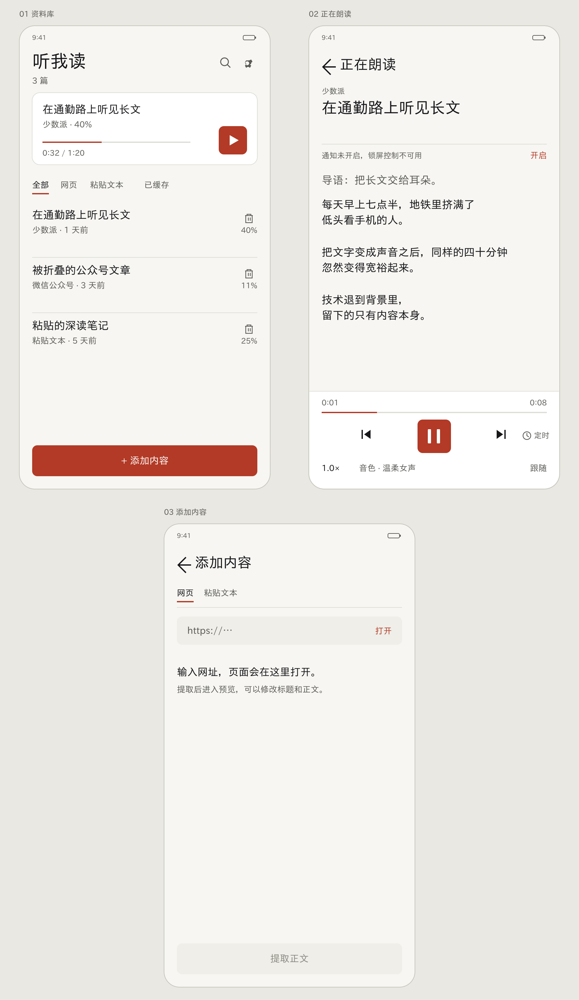

# 听我读 · UI v2 设计稿：「墨声」

- 状态：已实施（2026-11-20），待真机复核
- 日期：2026-11-20
- 范围：视觉系统、页面布局、组件状态、界面文案；移除阅读模式及其入口 / 页面 / 状态 / 测试；资料库为相对时间新增只读 `createdAt` 映射（不改 Room schema），其余信息架构 / 数据模型 / 服务行为不变。
- 参考：[kill-ai-slop](https://github.com/yetone/kill-ai-slop) 的 35 条 tell 与修复原则。



## 0. 结论

当前界面不是「渐变 + emoji」那种外显的 AI slop，而是更常见的**模板 slop**：Material 3 基线紫、默认圆角、默认字号、默认彩色容器，所有东西都对，但没有一个地方像是有意选的。

v2 只做三件事：

1. **把默认色换成一个有理由的系统**：纸、墨、一个朱砂色。朱砂只标记「正在发生」和「主要动作」，不铺满界面。
2. **把层级从颜色搬回字号、字重、留白、细线**。取消淡紫卡片、红底错误框、胶囊 chip。
3. **统一使用系统无衬线**：操作界面与长文正文都用无衬线；长文保留 18/32 与 24dp 边距。阅读模式整体移除，播放器只保留听与逐句跳转。

这是一个「阅读桌」而不是「AI dashboard」的方向：文字是内容，语音是唯一的活动信号，其余都退到纸面。

## 1. 诊断：当前界面的 slop 指纹

```text
slop  ui/theme/Color.kt:5-43                  M3 基线紫 + 紫调 surface（#6750A4 / #EADDFF / #FEF7FF）
                                              → 纸墨中性色 + 单一朱砂
slop  ui/theme/Type.kt:8-38                   6 个角色挤在 14–28；只有 28 / 22 / 16 / 14 四档，14 与 16 只差 2sp，层级靠灰
                                              → 28 / 22 / 18 / 16 / 13 五级，字重与留白承担层级
slop  ui/library/ContinueCard.kt:43-49        secondaryContainer 淡紫 + 20dp 圆角
                                              → 白纸 + 1dp 细线 + 12dp；朱砂只标进度与播放
slop  ui/library/LibraryScreen.kt:59-77       TopAppBar + FAB + 默认搜索框 / chips
                                              → 自绘页头 + 右上搜索图标 + 文字标签 / 底部主按钮
slop  ui/library/LibraryScreen.kt:141-168     OutlinedTextField 搜索框 + FilterChip 一排
                                              → 搜索移入页头；文字标签页
slop  ui/capture/CaptureScreen.kt:78-98       页头里两个返回箭头；URL 是 OutlinedTextField
                                              → 应用返回与网页返回分开；URL 是无边框填充条
slop  ui/capture/CaptureScreen.kt:257-268     巨大空白里一行居中提示
                                              → 左上说明块；空白是留给网页的，不是留给装饰的
slop  ui/capture/CaptureScreen.kt:301-338     半透明 overlay + errorContainer 状态框
                                              → 2dp 状态线 + 文字状态行
slop  ui/capture/PreviewScreen.kt:88-107      两个堆叠的 OutlinedTextField
                                              → 内容优先：标题 / 正文无边框字段 + 底部保存
slop  ui/player/PlayerScreen.kt:191-193       淡紫 HeroCard
                                              → 纸面标题块；当前句只用字重与深浅，无竖线
slop  ui/player/PlayerScreen.kt:267-300       红 / 灰状态卡叠在列表里
                                              → 三行文字状态；无容器
slop  ui/player/PlayerScreen.kt:328-364       当前句 primaryContainer + 圆形序号
                                              → 字重 + 深浅；无底色、无竖线
scope ui/player/ReadingScreen.kt / PlayerScreen.kt:62  阅读模式入口、页面、原文快照
                                              → 整体移除，不再维护
slop  ui/player/MiniPlayer.kt:49-94           tonalElevation + M3 进度条（末端圆点）
                                              → 顶部 1dp 细线 + 2dp 进度线；无 elevation
slop  ui/settings/SettingsScreen.kt:50-119    8dp 等间距 + 默认 RadioButton + 分隔线
                                              → 20 / 32 / 48 的关系间距；自绘选择行
slop  ui/settings/LlmSettingsSection.kt:64-94
      ui/settings/StepFunSettingsSection.kt:81-126   OutlinedTextField 墙
                                              → 标签在上、无边框填充字段
slop  ui/player/VoiceSheet.kt:41
      ui/library/DeleteResourceDialog.kt:18    默认 BottomSheet / AlertDialog
                                              → 自定义表面、行与动作
→ 7 组，约 23 处；另移除阅读模式。
```

这些不是 23 条彼此独立的审美罪状，而是同一个问题：**没有做选择**。Material 3 的基线值替产品做了色、形、字、层级和状态的全部决定；界面因此像一套还没换皮的模板。kill-ai-slop 的六条原则正好对症：

1. Decide before you decorate.
2. One accent, one voice.
3. Hierarchy from scale and space.
4. Subtract first.
5. Specific beats punchy.
6. Decoration must mean something.

## 2. 方向：「墨声」

### 2.1 概念

- **纸**：页面底色是近中性的纸白，不用紫调白，也不用暖黄「cozy」滤镜。
- **墨**：正文、标题、结构线都是墨色。层级靠字号、字重、留白和 1dp 细线，不靠彩色卡片。
- **朱砂**：整页唯一强调色，像校对笔标「正在发生」。它只出现在播放进度、主按钮和可执行文字动作上；当前句不再用颜色或竖线标记，错误也不另起一套红黄绿。
- **无衬线**：界面与正文统一使用系统无衬线；长文正文 18/32，操作界面 16/24–26。不捆绑字体。

### 2.2 为什么不是「编辑风 dashboard」

kill-ai-slop 的第 35 条警告「奶油底 + 展示衬线 + 深色强调 + 大号问候语」是新的模板。这个方案刻意避开：

- 没有大号问候语，没有装饰性字体排印，没有 tracked-caps kicker。
- 全部系统无衬线；层级来自字号、字重、留白和细线。
- 纸色是中性偏冷，不是奶油 / 琥珀 / 石色。
- 没有插图、徽章、渐变、玻璃、发光、emoji、吉祥物。

### 2.3 一个强调色的规则

朱砂是「活动信号」而不是「品牌装饰」：

- 播放进度条的已播放段。
- 主按钮（添加内容、提取正文、保存、删除确认）。
- 可执行的文字动作（开启、去设置、重新清洗、使用页面全文）。

当前句不使用朱砂，也不用竖线；过去句 `ink-2`，当前句 `ink` 600，未来句 `ink` 400。

错误与警告不靠底色：先写状态词，再写一句具体原因，最后给一个朱砂动作。没有 `errorContainer`，没有红底红字，也没有绿色「成功」块。成功的状态只需要文字本身。

## 3. 设计 tokens

### 3.1 颜色

| Token | Light | Dark | 用途 |
| --- | --- | --- | --- |
| `paper` | `#F7F6F2` | `#121210` | 页面底色 |
| `surface` | `#FFFFFF` | `#1A1A18` | 卡片、播放 dock、sheet、dialog |
| `sunken` | `#EFEEE8` | `#232320` | 搜索条、输入框、禁用按钮 |
| `ink` | `#17171A` | `#ECEBE5` | 正文、标题 |
| `ink-2` | `#5B5B57` | `#AAA9A1` | meta、次级说明、过去句 |
| `ink-3` | `#8A8A83` | `#7B7A73` | 仅禁用文字 / 非语义装饰 |
| `rule` | `#DEDED7` | `#2E2E2A` | 1dp 细线 |
| `rule-strong` | `#C4C4BB` | `#45453F` | 聚焦边框、需要更强的分隔 |
| `accent` | `#B23A26` | `#E07054` | 进度 / 主动作 / 文字动作 |
| `on-accent` | `#FFFFFF` | `#121210` | 朱砂上的文字和图标 |
| `scrim` | `#17171A` 32% | `#000000` 48% | dialog / sheet 遮罩 |

对比度：正文 `ink/paper` 16.5:1，meta 6.3:1，朱砂/纸 5.5:1，白/朱砂 6.0:1，深色朱砂/纸 5.9:1。`ink-3` 不承载正文；过去句用 `ink-2`，不用更浅的灰。

没有 `success` / `warning` / `error` 三色。错误靠「出错」「无法打开」这类词、字重和位置，不靠颜色。

### 3.2 字体

| 角色 | 字号 / 行高 | 字重 | 字体 | 用途 |
| --- | --- | --- | --- | --- |
| Display | 28 / 36 | 600 | 系统无衬线 | 只用于资料库 masthead |
| Title | 22 / 30 | 600 | 系统无衬线 | 页面标题、资源标题、dialog 标题 |
| Section | 18 / 24 | 600 | 系统无衬线 | 设置分区、列表分区标题 |
| Body | 16 / 26 | 400 | 系统无衬线 | 说明、正文 |
| Body medium | 16 / 24 | 500 | 系统无衬线 | 列表标题、次级动作 |
| Body strong | 16 / 24 | 600 | 系统无衬线 | 当前句、按钮、状态词 |
| Meta | 13 / 20 | 400 | 系统无衬线 | 来源、相对时间、进度、帮助文字 |
| Numeric | 13 / 18 | 500 | 系统无衬线，tabular | 时间码、百分比 |
| Long text | 18 / 32 | 400 | 系统无衬线 | 长文正文、预览正文、文本输入 |

不引入 14sp 独立层级；以前 14sp 的 label 用 13sp 或 16sp 的角色替代。界面字号只有 28 / 22 / 18 / 16 / 13 五档，靠字重和留白制造层级。

字体的选择理由：全站使用系统无衬线（Roboto / Noto Sans CJK），保证字形覆盖、阅读速度和零下载；长文正文用 18/32 的字号行高，不依赖衬线。不捆绑 CJK 字体，避免几 MB 的 APK 增量。

### 3.3 间距

- 页面左右边距：20dp；长文正文 24dp。
- 页头：状态栏下 12dp，标题下 20dp。
- 列表行：上下 16dp；标题到 meta 6dp；meta 到进度 8dp。
- 同组元素：4 / 8 / 12dp。
- 组与组：32 / 40 / 48dp。
- 按钮高 48dp；输入框高 44dp；触控目标不小于 48dp。
- 同一个 8dp 不再刷满整页；距离表达归属关系。

### 3.4 形状

- `4dp`：小标记、状态方点。
- `8dp`：按钮、输入框、搜索条、播放键。
- `12dp`：卡片、sheet、dialog。
- 没有全圆角胶囊；只有状态点可以是圆的。
- 嵌套时内层半径 = 外层半径 − 间距；不使用同一个大圆角套所有层。

### 3.5 高度与浮层

- 内容区一律 0 elevation，用纸色 / 细线分隔。
- 只有真正浮起来的表面（菜单、sheet、dialog）有一级阴影：`0 2px 8px rgba(23,23,26,.12)`；深色 `0 2px 8px rgba(0,0,0,.40)`。
- 不使用 tonalElevation，不用彩色阴影，不用发光。

### 3.6 动效

- 状态变化：150ms，标准 decelerate；只过渡背景、透明度、颜色。
- 按压：8% ink overlay；不缩放、不弹跳。
- 进度：线性；不闪烁、不脉冲。
- 跟随滚动：200ms；只跟随当前句，不做自动播放动画。
- 没有装饰性入场动画。

## 4. 基础组件

| 组件 | 规格 |
| --- | --- |
| `PageHeader` | 56dp 高；22/600 标题；24dp 返回图标；右侧最多一个文字动作（如「开启」）；20dp 边距；无阴影；尊重状态栏 inset。 |
| `Masthead` | 28/600 产品名 + 13/400 meta + 24dp 搜索图标 + 24dp 设置图标；搜索在设置左侧；20dp 边距；只用于资料库。 |
| `TextTabs` | 13/500，间距 16dp；选中 600 + 2dp 朱砂下划线；整组底部 1dp `rule`；不用 chip。 |
| `PrimaryAction` | 48dp 高，8dp 圆角，`accent` 填充，`on-accent` 16/600；禁用时 `sunken` 底 + `ink-3` 字；不用胶囊。 |
| `QuietAction` | 纯文字，48dp 触控高度；`accent` 或 `ink-2`；无容器、无描边。 |
| `LrTextField` | 13/400 标签在上，间距 6dp；输入区 44dp，`sunken` 填充，8dp 圆角，无描边；聚焦 1dp `rule-strong`；文字 16/400；帮助 / 错误文字 13/400 在下；不用 floating label。 |
| `SearchField` | 默认收起；点 `Masthead` 搜索图标后展开 44dp 行；`sunken` 填充，8dp 圆角；18dp 搜索图标；16/400 占位；有内容时右侧 16dp 清除图标；收起时清空。 |
| `ListRow` | 上下 16dp；16/500 标题；13/400 meta（友好来源 · 相对时间）；进度百分比 13/500 tabular 右对齐；可选 2dp 进度线；行尾 20dp 垃圾桶；行间 1dp `rule`；不显示句数 / 已缓存；不用卡片。 |
| `StatusLine` | 16/600 状态词 + 13/400 说明 + 朱砂文字动作；无容器；需要分区时才加 1dp 上下细线。 |
| `ProgressLine` | 2dp 高；`rule` 轨道；`accent` 已播放 / 已完成段；无末端圆点；时间用 13 tabular。 |
| `ContinueCard` | `surface` + 1dp `rule` + 12dp 圆角 + 16dp 内边距；16/600 标题；13 meta（来源 · 40%）；2dp 进度；44dp 朱砂播放键（8dp 圆角）；没有「继续收听」标签。 |
| `PlayerDock` | `surface` + 顶部 1dp `rule`；20dp 水平边距 / 12dp 垂直边距；13 tabular 时间；2dp 进度；左 40dp 上一句（`|◀`）/ 52dp 朱砂播放键 / 右 40dp 下一句（`▶|`）；图标方向按控制语义，不能反；睡眠定时文字动作；13 的倍速 / 音色 / 跟随行。 |
| `Sheet` | `surface`；顶部 12dp 圆角；顶部 1dp `rule`；32×4 `rule` 拖拽条；20dp 内边距；22/600 标题；行高 56dp；背景 `scrim`。 |
| `Dialog` | `surface`；12dp 圆角；20/24dp 内边距；1dp `rule` + 浮层阴影；22/600 标题；16/26 说明；动作右对齐；删除确认用朱砂文字，不用红色按钮。 |
| `ChoiceRow` | 56dp 高；16/500 标签；16dp 自绘单选圆（1dp `rule` 圆，选中朱砂填充）；行间 1dp `rule`；3–5 个互斥选项优先用 `TextTabs`，不用一列 radio。 |

## 5. 页面规格

### 5.1 资料库

结构：

1. `Masthead`：产品名 + 「3 篇」+ 搜索图标 + 设置图标；搜索在设置左侧。
2. `ContinueCard`：唯一的一张卡；标题、来源 · 40%、2dp 进度、播放键；没有「继续收听」标签。
3. `SearchField`：默认收起；点搜索图标展开 44dp 行；清除或收起时还原。
4. `TextTabs`：全部 / 网页 / 粘贴文本 / 已缓存；选中朱砂下划线。
5. 列表：按添加时间倒序；无卡片，行间 1dp 细线；标题 16/500；meta 13（友好来源 · 相对时间）；右侧进度百分比 13/500 tabular；不显示句数 / 已缓存；行尾 20dp 删除图标。
6. 底部主按钮：「添加内容」，吸底，20dp 边距，48dp 高。

来源名按预置映射：`mp.weixin.qq.com` → 微信公众号，`sspai.com` → 少数派，`zhihu.com` → 知乎；未知域名显示域名。时间用相对时间（1 天前 / 3 天前 / 5 天前）。

状态：

- 加载：masthead 下 2dp 不确定进度线 + 13 「正在加载」；不阻塞页面。
- 空：左上说明块：「还没有内容」22/600 + 「粘贴一篇长文，或输入网页链接。提取后会生成语音。」16/400；底部主按钮仍然可见，不在空状态里重复一个按钮。
- 无匹配：说明块「没有匹配的内容」+「换个词，或清除筛选。」+「清除筛选」朱砂文字动作。
- 错误：masthead 下 `StatusLine`：「出错」+ 具体原因 + 「重试」。
- 列表超过一屏：内容滚到底部按钮上方；按钮不随列表滚动。

交互：点卡片 / 行进入播放器；删除图标打开确认 dialog；点搜索图标展开 `SearchField`，输入即过滤；清除或收起后恢复列表；筛选标签切换即过滤。

### 5.2 添加内容

结构：

1. `PageHeader`：「添加内容」+ 返回；不再放网页后退 / 刷新。
2. `TextTabs`：网页 / 粘贴文本。
3. 网页模式：URL 填充条（右侧「打开」朱砂文字）；页面加载后，在 URL 下方出现一条 36dp 的页面工具栏（20dp 后退 / 刷新图标 + 13 域名），与 App 返回分开。
4. WebView：全宽、方角、顶到工具栏；不套圆角卡片。
5. 状态条：URL 与网页之间；加载 / 提取时 2dp 线 + 13 文字；不用半透明 overlay。
6. 底部主按钮：「提取正文」；无 URL 时禁用。
7. 文本模式：正文输入区占满剩余高度；18/32 无衬线；无边框；标签「正文」13 在上；底部「预览」主按钮。

状态：

- 空：左上说明块「输入网址，页面会在这里打开。」16/400 +「提取后进入预览，可以修改标题和正文。」13/400；不居中，不放插图。
- 加载：`正在加载网页… 42%` + 2dp 进度线；不覆盖网页。
- 需要用户操作：`StatusLine`「需要操作」+ 原因 + 「完成页面操作后点「提取正文」。App 不会自动登录或提交表单。」；中性表面，不用红色。
- 出错：`StatusLine`「无法打开」/「提取失败」+ 具体原因 + 「重试」；不用红框。
- 提取中：按钮文案「正在提取…」，禁用；状态条 2dp 不确定线。
- 正文不完整：`StatusLine`「正文可能不完整」+ 原因 + 「使用页面全文」朱砂文字动作。

### 5.3 预览

结构：

1. `PageHeader`：「预览」+ 返回。
2. 标题字段：22/600，无边框，底部 1dp `rule`；标签「标题」13。
3. 正文字段：18/32 无衬线，无边框，最小 12 行；标签「正文」13；下方 1dp `rule`。
4. meta：「66 字 · 2 句 · 来源：粘贴文本 · LLM 清洗」13 `ink-2`。
5. `StatusLine`：分段状态。
6. 底部主按钮：保存，吸底。

分段状态：

- 运行中：2dp 不确定线 + 「正在用 LLM 清洗并分段…」13。
- 成功：「已清洗，2 段。」13。
- 失败：「清洗失败」16/600 + 具体原因 + 「重新清洗」朱砂动作；保存按钮文案「保存（按规则分段）」。
- 未配置：「未配置 LLM」16/600 + 「分段会按规则进行。」13 + 「去设置」「重新清洗」两个文字动作。
- 未运行：「当前按规则分段。」13 + 「重新清洗」动作。
- 不完整提示：「正文可能不完整」16/600 + 原因 13 + 「使用页面全文」朱砂动作。无红色。

### 5.4 播放器

结构：

1. `PageHeader`：「正在朗读」+ 返回；右侧不再有「阅读模式」。
2. 标题块：来源 13 `ink-2`；资源标题 22/600；不再放句数 / 音色 / 倍速 meta。
3. 通知行：1dp 上细线；「通知未开启，锁屏控制不可用」13 + 「开启」朱砂动作。
4. 逐句列表直接开始：句子从 20dp 边距开始，无行号；过去 `ink-2`；当前 `ink` 600；未来 `ink` 400；无竖线、无序号强调色、无缓存勾；整行可点，点击跳句。
5. `PlayerDock`：时间、2dp 进度、上一句 / 播放 / 下一句、睡眠定时；第二行倍速 / 音色 / 跟随。

状态：

- 无 Key：「还没有音频」16/600 + 「播放时会合成音频，并缓存在本机。」13 + 「设置」动作；无灰底卡片。
- 错误：标题块下 `StatusLine`「出错」+ 原因 +「去设置」/「重试这句」；无红框。
- 通知未授权：一行，不用卡片。
- 合成中：当前句右侧 12dp 细环；dock 显示「正在合成…」13 `ink-2`，不用彩色脉冲点。
- 已缓存：不显示勾或「已缓存 N/M 句」的彩色小字；需要时只在状态行写「已缓存」。

### 5.5 阅读模式：移除

第一轮审核决定砍掉阅读模式。删除 `ReadingScreen`、播放器标题栏的「阅读模式」入口、原文快照页、`ReaderAudioBar`、相关状态 / 字符串 / 测试；播放器只保留听与逐句跳转。原文快照不再维护。空状态与播放器文案不再提「阅读模式」。

### 5.6 设置

结构：

1. `PageHeader`：「设置」+ 返回。
2. 外观：`TextTabs` 三选一（跟随系统 / 浅色 / 深色）；40dp 高；选中朱砂下划线。
3. 朗读服务：Key 字段（标签在上、无边框）；「Key 已加密保存」13；模型用 2 个 `ChoiceRow`；音色一行「当前音色 · 温柔女声」+「切换」；「保存 Key」为全页唯一的朱砂实心主按钮；「测试连接」「清除 Key」用文字动作，清除需确认。
4. LLM 清洗：端点 / 模型 / Key 字段；「Key 已配置」13；「保存并测试」「仅保存」「清除 Key」均为文字动作；错误用 `StatusLine`。
5. 预取：一行 `TextTabs`「关闭 / 2 / 4 / 6 / 8」；说明 13。
6. 存储：两行 label/value（当前音轨 / 旧音轨），数值 tabular；「清理旧音轨」文字动作；说明 13。
7. 分区之间 1dp `rule` + 32–40dp 间距；分区内 8–12dp；不再用 8dp 等间距刷满整页。

### 5.7 弹层与对话框

- 音色 sheet：22/600「音色」；当前模型 13；行高 56；自绘单选；选中名称 600 + 6dp 朱砂方点；右侧「试听」朱砂动作；合成中 12dp 细环 +「合成中」13；错误 `StatusLine`。
- 睡眠定时菜单：`surface` + 8dp 圆角 + 1dp `rule` + 浮层阴影；行高 48；5 / 15 / 30 / 60 分钟 + 关闭；无装饰图标堆。
- 删除确认：22/600「删除这篇内容？」；16/26 说明「会删除朗读文稿、缓存音频和原文快照，无法恢复。」；动作「取消」`ink-2` /「删除」朱砂 600。
- 通知权限：一行文字 + 「开启」；不弹二次卡片。

## 6. 文案

规则：说具体的事，不喊口号；不用「不只是 X，而是 Y」；不用 em dash 制造戏剧；不在界面里暴露内部术语（L2、AudioTrack 的实现细节）；不加感叹号。

| 现在 | 改为 |
| --- | --- |
| 新建 / 采集 | 添加内容 |
| 输入网址开始采集 | 输入网址，页面会在这里打开。 |
| 重试 L2 | 重新清洗 |
| 保存（规则分段） | 保存（按规则分段） |
| 定时 | 睡眠定时 |
| 跟随 / 自由 | 跟随朗读 / 自由浏览 |
| 已听 0% | 删掉；用「40%」+ 相对时间 |
| 第 2 / 5 句 | 40% |
| 还没有缓存的音频。播放时会按设置里的 TTS 配置逐句合成。 | 还没有音频。播放时会合成音频，并缓存在本机。 |
| 把网页链接或一段文字加进来，听我读会把它变成可以收听的朗读文稿。 | 粘贴一篇长文，或输入网页链接。提取后会生成语音。 |
| 正文可能不完整：提取置信度较低（可编辑正文，或使用页面全文） | 正文可能不完整。可以编辑，或使用页面全文。 |
| 尚未配置 Key，采集时只能使用规则分段。 | 还没有配置 LLM。分段会按规则进行。 |
| 通知未开启，锁屏控制不可用 | 通知未开启，锁屏控制不可用。 / 开启 |

## 7. 实施 handoff

### 7.1 范围与非范围

范围：主题 tokens、字体、组件外观、页面布局、状态呈现、界面文案、视觉快照；移除阅读模式及其入口 / 页面 / 状态 / 测试。

非范围：除阅读模式外的信息架构 / 导航、数据模型、Room schema、TTS / L2 行为、新功能、动态取色、捆绑字体、自定义图标集、装饰性动画。

表面增量：+0 命令、+0 环境变量、+0 服务、+0 依赖。新增的只是共享 Compose wrapper，用来替代散落的 Material 3 默认用法；没有新增重试、fallback 或配置开关。

### 7.2 涉及文件

这次改动会触及约 30 个 Kotlin 文件（含新增组件与测试），超过 8 个；建议一个 PR 承载完整视觉切换，提交按 4 组拆分，避免发布半套皮肤。

- 主题：`ui/theme/Color.kt`、`Theme.kt`、`Type.kt`，新增 `Dimens.kt`。
- 基础组件：新增 `ui/components/PageHeader.kt`、`TextTabs.kt`、`Controls.kt`（主按钮 / 文字动作 / 字段）、`StatusLine.kt`、`ProgressLine.kt`、`ChoiceRow.kt`；改写 `EmptyState.kt`。
- 资料库：`ui/library/LibraryScreen.kt`、`ContinueCard.kt`、`DeleteResourceDialog.kt`。
- 添加 / 预览：`ui/capture/CaptureScreen.kt`、`PreviewScreen.kt`、`L2StatusSection.kt`。
- 播放：`ui/player/PlayerScreen.kt`、`MiniPlayer.kt`（拆成 `PlayerDock`）、`VoiceSheet.kt`、`SleepTimerMenu.kt`、`NotificationPermission.kt`；删除 `ReadingScreen.kt` / `ReaderAudioBar`、播放器标题栏的阅读入口与相关状态 / 字符串 / 测试。
- 设置：`ui/settings/SettingsScreen.kt`、`StepFunSettingsSection.kt`、`LlmSettingsSection.kt`、`StorageSection.kt`。
- 应用壳：`ListenReaderApp.kt`（主题入口）、`MainActivity.kt`（系统栏图标明暗）。
- 测试：`app/src/test/java/com/cnife/listenreader/ui/UiSnapshotTest.kt`（更新 3 个核心屏 + 新增深色 / 空 / 错误 / 无 Key / 音色 sheet 快照；删除阅读模式相关快照与断言）。

### 7.3 实施顺序（同一分支，按提交）

1. `ui: 建立墨声主题与基础组件` —— tokens、字体、圆角、间距、按钮 / 字段 / 标签页 / 状态行 wrapper。只换基础层，页面行为不动；应用可编译、可运行。
2. `ui: 重做资料库与添加流程` —— 资料库、继续卡、空状态、添加内容、预览、L2 状态。此提交后主流程已是新皮肤，可独立使用。
3. `ui: 重做播放器并移除阅读模式` —— 播放器、播放 dock、音色 sheet、通知行；删除 `ReadingScreen` / `ReaderAudioBar`、阅读入口、状态、字符串和测试。
4. `ui: 重做设置与弹窗` —— 设置分区、删除 dialog、睡眠菜单、存储区。

每个提交都必须能独立构建；PR 作为一个完整变更合入。这不是 4 个可独立发布的阶段，而是一次完整切换的 4 个审阅单元；不要先合半套皮肤再等后续提交。

### 7.4 验证

紧循环（每次改动）：

```bash
ANDROID_HOME=${ANDROID_HOME:-$HOME/Android/Sdk} ./gradlew :app:testDebugUnitTest --console=plain
```

视觉快照：

```bash
./gradlew :app:testDebugUnitTest --tests "com.cnife.listenreader.ui.UiSnapshotTest"
```

然后 `read` 打开 `app/build/outputs/roborazzi/` 下的 PNG，逐屏对照 `docs/design/ui-v2-mockup.png`。如果改了测试 tag 或文案：

```bash
./gradlew :app:compileDebugAndroidTestKotlin
```

设备冒烟（UI 触及 WebView / edge-to-edge / 播放 dock）：

- 按 `docs/agents/verification.md` 用 `hs` 驱动真机 / 模拟器，`-PappIdSuffix=.nmtest` 隔离安装。
- 检查浅色 / 深色、字体缩放 1.3× 与 2.0×、刘海 / 导航栏 inset、WebView 全宽、软键盘顶起输入区。
- 资料库 → 添加 → 预览 → 保存 → 播放 → 设置走一遍；用 mock server 或已有 Key 验证音频 dock 的真实状态。
- 错误态：无 Key、无网络、提取失败、通知未授权。

通过标准：

- 三张核心屏与 mockup 的层级一致：纸 / 墨 / 单一朱砂；没有淡紫卡片、默认 chip、红底错误框、M3 进度末端圆点、胶囊按钮。
- 浅色 / 深色 / 1.3× / 2.0× 字体缩放下，标题、meta、当前句、按钮都可读；对比度符合第 3.1 节。
- 阅读模式入口、`ReadingScreen`、`ReaderAudioBar` 已删除；播放器标题栏不再出现「阅读模式」。
- 所有既有行为测试通过；测试 tag 与业务语义不变；没有新增依赖、命令、配置或服务。
- 设备上能走通资料库 → 添加 → 预览 → 保存 → 播放 → 设置；错误、无 Key、通知未授权三类状态都能到达并显示为文字状态行。

### 7.5 回滚

UI 与阅读模式移除，无 Room schema、无数据迁移、无外部状态；回滚 = revert 该 PR，恢复阅读模式入口 / 页面 / 测试。主题设置会保留用户选择，但不会破坏旧界面。WebView / Media3 行为不变，回滚不需要清理缓存。

### 7.6 风险与最脆弱假设

**最脆弱的假设：当前句只靠字重和深浅仍能被一眼认出。**

修订版去掉了朱砂竖线，当前句用 `ink` 600 与相邻句的组间距区分，过去句 `ink-2`，未来句 `ink` 400。灰度 / 色盲 / 1.3× 字体缩放测试如果在 1 秒内认不出，先把当前句字重提到 600、上间距加到 12dp，再考虑加大字号；不恢复竖线。owner = omp，实施播放器第一屏时验证。

其他风险：

- **错误状态不够显眼**：单一强调色意味着错误没有专属红色。先在灰度 / 色盲模拟下看「出错」+ 原因 + 动作是否能在 1 秒内被识别；如果不行，只给错误词加一个低饱和砖红，不恢复红底卡片。这是唯一可能改变配色决策的证据。
- **搜索图标发现率**：搜索从常驻框变成页头图标后，第一次可能找不到。图标保持 48dp 触控区；如果真机测试发现率低，只加一个一次性提示，不恢复常驻搜索框。
- **字体缩放**：播放 dock 的第二行在 2.0× 可能溢出；允许换行，不缩字号。
- **M3 默认泄漏**：`Button` 默认是胶囊、`OutlinedTextField` 默认带框、`LinearProgressIndicator` 默认有末端圆点。必须用 wrapper，不直接用默认组件；靠快照审查兜底。
- **WebView inset**：全宽 WebView 需要正确处理 cutout / 导航栏；真机验证。
- **测试 tag / 文案断言**：保留 `library-new`、`capture-url-input` 等行为 tag；只改视觉的 tag 不要重命名。文案断言按新文案更新，不为了测试保留旧文案。

### 7.7 最小方案（不推荐）

只替换 `Color.kt` / `Type.kt`：约 2 个文件、半天，能去掉紫色，但保留 M3 默认胶囊、OutlinedTextField、淡紫卡片和 8dp 等间距；用户看到的仍然是「换了颜色的模板」。这个方案在风险 / 回滚上更轻，但解决不了本次的核心抱怨。

### 7.8 批准后的下一步

阻塞歧义：无。第一轮已定：朱砂 #B23A26、全无衬线 18/32、移除阅读模式；修订版不再重开这三项。

1. 潭渊复核修订版；第一轮已定项不再重开。
2. 按 7.3 建功能分支，先提交主题与基础组件；每个提交跑紧循环 + 快照。
3. 全量完成后跑设备冒烟，PR 附三张新快照与 mockup 对照。
4. PR 由潭渊批准后合并；不合入半套皮肤。
